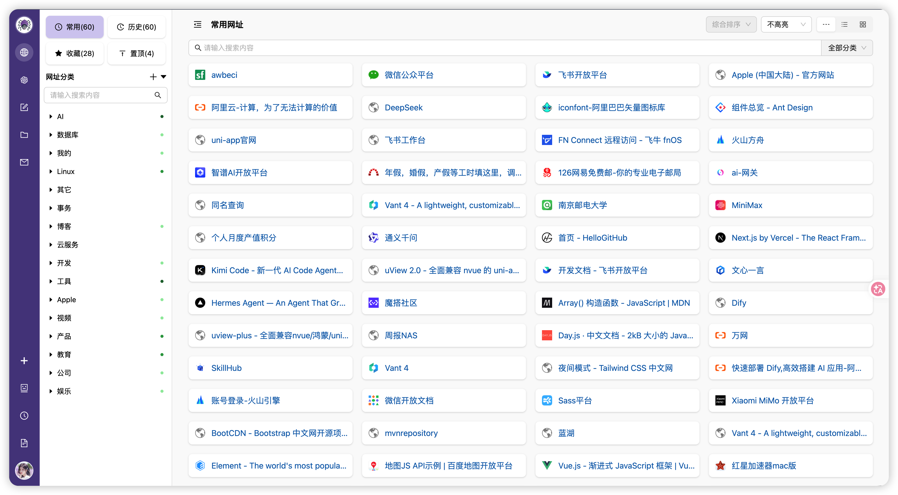
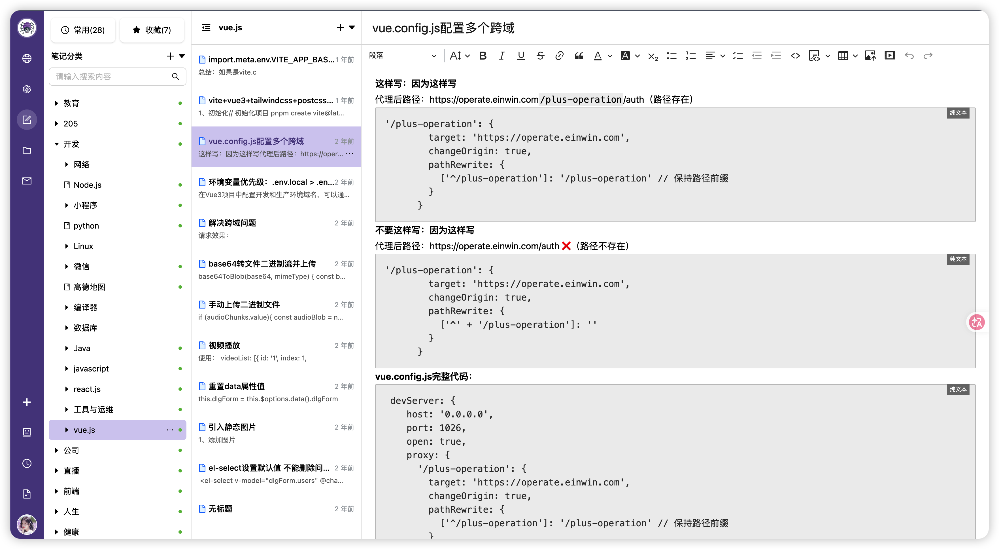
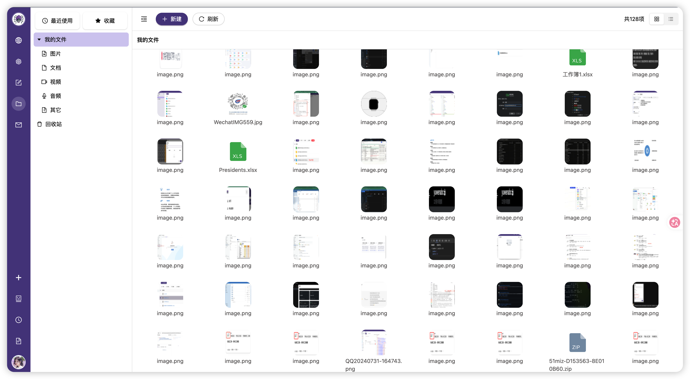
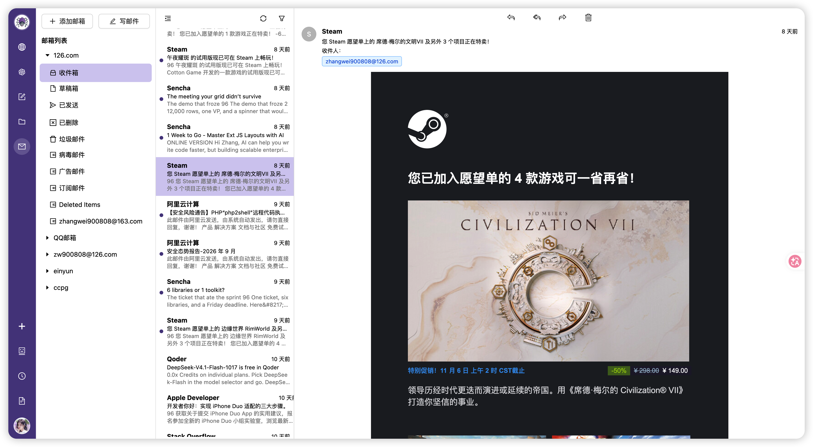

# Seaurl Web

**把网址、笔记、文件和 AI 工具放进同一个工作空间。**

Seaurl Web 是 Seaurl 的开源 Web 前端，基于 Next.js 14 和 React 构建。你可以用它整理日常收藏、记录知识、管理文件，也可以通过内置工具完成 AI 对话、文档编辑和开发辅助工作。

[源码仓库](https://github.com/seaurl/seaurl-web) · [问题反馈](https://github.com/seaurl/seaurl-web/issues) · [参与贡献](#参与贡献)

## 主要功能

| 模块 | 能力 |
| --- | --- |
| 网址空间 | 分类管理、收藏与搜索网址 |
| 笔记空间 | 分类管理笔记、富文本编辑、插入图片 |
| 文件空间 | 文件与目录管理、上传下载、预览及 OnlyOffice 文档编辑集成 |
| AI 工作空间 | 工具目录与最近使用、AI 对话、图片生成、翻译 |
| 实用工具 | Markdown、代码编辑与对比、JSON 格式化、HTTP 请求调试、二维码、计算器 |
| 图形工具 | Excalidraw 白板、draw.io 绘图、BPMN 流程建模 |
| 个人工作台 | 邮箱、聊天室、日历、工时记录，以及账号和外观设置 |

本仓库提供页面、交互和部分 Next.js 服务端 API。账号、数据持久化、文件存储、通知及多数 AI 能力需要配套 Seaurl 后端；运行前端开发服务并不等于已经部署完整系统。工具目录由后端数据驱动，具体可用功能还取决于后端配置和第三方服务。

## 界面预览

### 网址空间



### 笔记空间



### 文件空间



### 邮件空间



## 技术栈

| 用途 | 技术 |
| --- | --- |
| 应用框架 | Next.js 14.2.7，App Router |
| 界面与样式 | React 18、Ant Design 5、Tailwind CSS、SCSS Modules |
| 身份会话 | next-auth 5.0.0-beta.20，JWT 会话 |
| 状态与请求 | Redux Toolkit、Axios |
| 编辑与图形 | CKEditor 5、Monaco Editor、Excalidraw、BPMN.js、OnlyOffice |
| 浏览器存储 | Dexie / IndexedDB |

## 快速开始

### 1. 准备环境

- 建议使用 Node.js 24 LTS 和 npm；当前 `pdfjs-dist` 依赖要求 Node.js 22.13.0 或更高的 22.x，或 Node.js 24 及以上。
- 一个可访问的 Seaurl 后端 API；本地示例地址为 `http://localhost:7777/api`，请按实际部署修改。
- 使用注册、邮箱验证等流程时，准备对应的验证码和邮件服务配置。

### 2. 获取源码并安装依赖

```bash
git clone https://github.com/seaurl/seaurl-web.git
cd seaurl-web
npm install
```

仓库当前通过 `.gitignore` 忽略锁文件，新克隆项目使用 `npm install` 安装依赖。

### 3. 配置环境变量

```bash
cp .env.example .env.development
```

编辑 `.env.development`，填写 `AUTH_SECRET` 并确认后端地址。可用以下命令生成随机密钥，再将输出填入配置文件：

```bash
node -e "console.log(require('node:crypto').randomBytes(32).toString('hex'))"
```

`.env.development` 已被 Git 忽略，适合保存本地开发配置。如果使用 `.env.local`，请先将它加入本地 `.git/info/exclude`：当前 `.gitignore` 中忽略 `.env*.local` 的规则被注释，不能直接假定该文件不会被提交。

| 变量 | 用途 | 示例 / 配置说明 |
| --- | --- | --- |
| `AUTH_SECRET` | next-auth 会话密钥，仅服务端使用 | 填入生成的随机字符串 |
| `NEXTAUTH_URL` | 应用访问地址，用于认证相关 URL | `http://localhost:3000` |
| `NEXT_PUBLIC_HOST` | 应用公开地址配置项 | `http://localhost:3000`；当前源码未直接引用 |
| `NEXT_PUBLIC_API_HOST` | 后端 API 基础地址，浏览器和 Next.js 服务端均会使用 | `http://localhost:7777/api` |
| `NEXT_PUBLIC_WEBSOCKET_HOST` | 通知 / 聊天 WebSocket 基础地址 | `ws://localhost:7777/api` |
| `NEXT_PUBLIC_SCENE_ID` | 阿里云验证码场景 ID | 使用注册、密码重置等流程时配置 |
| `NEXT_PUBLIC_WEATHER_FREE_HOST` | 和风天气免费接口地址配置项 | 模板默认为 `https://devapi.qweather.com`；当前源码未直接引用 |
| `NEXT_PUBLIC_WEATHER_STANDARD_HOST` | 和风天气接口地址 | 模板默认为 `https://api.qweather.com`，按实际服务配置 |

`NEXT_PUBLIC_` 变量会暴露给浏览器，不能放服务端密钥。它们会在生产构建时写入客户端代码，修改后需重新构建。`AUTH_SECRET` 不要添加 `NEXT_PUBLIC_` 前缀。

### 4. 启动开发服务

```bash
npm run dev
```

打开 [http://localhost:3000](http://localhost:3000)。登录和数据操作需要后端可用；注册流程还需要验证码等依赖正常工作。

## 常用命令

| 命令 | 说明 |
| --- | --- |
| `npm run dev` | 启动开发服务器，默认端口 3000 |
| `npm run build` | 构建生产版本 |
| `npm run start` | 启动已构建的生产版本 |
| `npm run lint` | 调用 `next lint`；仓库尚未提供 ESLint 配置，首次运行可能进入配置引导 |

目前没有独立的自动化测试脚本。

## 构建与部署

### Node.js 服务

准备生产配置后构建，再启动服务：

```bash
cp .env.example .env.production
# 编辑 .env.production，设置生产访问地址、后端地址和会话密钥
npm run build
npm run start
```

`.env.production` 已被 Git 忽略。若本地还有 `.env.local` 或 `.env.production.local`，请检查是否覆盖了生产配置。构建期间部分页面会请求后端数据，构建环境也需要能访问对应 API。

应用使用了服务端会话、API 路由和服务端数据请求，需要运行 Next.js 服务，不能只把静态文件放到 Web 服务器上。

仓库提供 [docker/Dockerfile](docker/Dockerfile)，通过 pnpm 安装、构建和启动应用。现有模板使用 Node.js 20，与当前 PDF 依赖的版本要求不一致，容器部署前需调整基础镜像。它还会通过 `COPY . .` 将构建目录中的环境文件复制进镜像，应调整构建上下文与密钥注入方式后再用于发布。

### 后端与反向代理

- `NEXT_PUBLIC_API_HOST` 会被浏览器和 Next.js 服务端共同使用，必须从两端都能访问。跨域部署时，后端需允许前端来源及 `token-id` 等请求头。容器内的 `localhost` 指向容器自身，不能直接套用宿主机的后端地址。
- `/api/auth/*` 和 `/api/ai/chat` 属于 Next.js。本地与同域部署都要保留这些路由，不能将整个 `/api/*` 无差别转发到 Java 后端。可为业务 API 配置独立域名或明确的路由规则。
- HTTPS 部署时，相应公开地址使用 `https://`，WebSocket 使用 `wss://`；代理需支持 WebSocket 升级和 SSE 流式响应。
- AI 助手需要配置模型、API Key 和服务地址；OnlyOffice、draw.io 等工具需要对应服务。部分组件仍直接引用 `seaurl.com` 下的服务和 CDN 地址，自部署时需要检查并替换这些引用，仅修改环境变量不能覆盖全部外部依赖。

## 目录结构

```text
seaurl-web/
├── docker/                 # 容器构建文件
├── public/                 # 静态资源
├── src/
│   ├── app/                # App Router 页面与服务端 API
│   │   ├── (auth)/         # 登录、注册
│   │   ├── (account)/      # 密码重置、邮箱验证
│   │   ├── (home)/         # 首页相关组件、推荐与排行
│   │   ├── (user)/         # 工作台、个人空间与设置
│   │   ├── (system)/       # 广场、隐私与使用条款
│   │   └── api/            # next-auth、AI 助手接口
│   ├── components/         # 业务组件；aihub/ 为工具实现
│   ├── context/            # 会话、Redux 与主题 Provider
│   ├── db/                 # 工具相关 IndexedDB 数据访问
│   ├── hoc/                # 高阶组件
│   ├── lib/                # 认证、请求、会话缓存与 Redux slices
│   ├── template/           # 开发模板
│   └── utils/              # 通用工具
├── .env.example            # 环境变量模板
├── next.config.mjs         # Next.js 配置
├── package.json            # 依赖与运行脚本
└── tailwind.config.js      # Tailwind CSS 配置
```

## 开发说明

路径别名 `@/*` 对应 `src/*`。新增功能可参考已有页面与同名 Redux slice，工具组件集中在 `src/components/aihub/`。

<details>
<summary>会话、主题与 HTTP 调试工具的实现约定</summary>

### 登录、续期与退出

1. 登录页调用后端 `/users/web/login`，成功后将返回的数据交给 `signIn("credentials", …)`。
2. `src/lib/auth.js` 将 `uid`、后端 `tokenId` 写入 JWT，并向会话提供 `accessToken`。Axios 拦截器以 `token-id` 请求头携带令牌，会话查询有 30 秒缓存。
3. `SessionProvider` 每 5 分钟重新获取会话，当前关闭窗口聚焦刷新和离线刷新。后端令牌续期由 `ChildrenLayout` 在首次加载和页面可见性变化时检查；获得新令牌后调用 `update({ newTokenId })` 并使请求会话缓存失效。
4. 退出操作先调用后端 `logoutAll`，成功后执行 `signOut()`；账号信息修改也会触发相关退出流程。设备和令牌失效规则由后端负责，前端在续期返回过期状态时提示重新登录。

### 主题同步

外观设置同步到后端、localStorage 和 Redux `systemSlice`。`ChildrenLayout` 读取账号信息后同步主题，`AntdProvider` 根据状态设置组件主题，并处理跟随系统的外观切换。

### HTTP 请求调试

工具收集目标 URL、方法、请求头和请求体，再请求后端代理接口：

- 普通请求：`/space/crud/httpRequest/proxy`
- FormData 请求：`/space/crud/httpRequest/proxy/formData`

响应根据 `Content-Type` 区分文本、JSON、文件及 `text/event-stream`。维护 Monaco 编辑器时，传入值应为字符串；格式化前需允许编辑，并确认语言模式及容器高度。发送 FormData 时不要手动填写 multipart 边界，由浏览器生成。

</details>

## 参与贡献

欢迎反馈问题、改进文档、完善工具或提交修复。

1. 在 [Issues](https://github.com/seaurl/seaurl-web/issues) 中描述问题或建议；报告问题时附上复现步骤、预期结果、实际结果和运行环境。
2. Fork 仓库并创建分支，围绕一个明确问题进行修改，沿用现有目录和组件风格。
3. 检查受影响页面，运行 `npm run build`；若已配置 ESLint，再运行 `npm run lint`。涉及后端或第三方服务时，说明验证条件和未覆盖部分。
4. 提交 Pull Request，说明修改目的、主要变化和验证结果；界面变更可附截图。提交前确认没有包含密钥、本地环境文件或个人数据。

## 许可证

当前仓库尚未提供源码 `LICENSE` 文件；具体授权范围需由维护者明确。站内 `/license` 页面是产品使用协议，不等同于源码许可证；第三方依赖遵循各自许可证。
